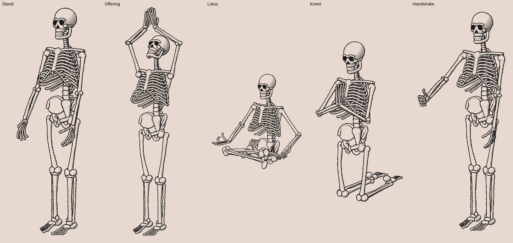

# Skeleton Poser

Pose a 3D skeleton in the browser and export it as ink-style line art for screen printing:
transparent PNG (up to 6000 px) or vector SVG with ink and bone fill as separate groups.



## What it does

- **Posing:** nine starting poses; rotate any joint, or drag a hand, a foot or the whole body and the elbow or knee follows. Hand shapes (open, fist, point, peace, mudra), jaw, mirror, undo.
- **Ink:** line weight, hatching, halftone dots or stipple shading, light direction, hand wobble, worn-print texture, ink color, optional second color for the bones.
- **Export:** transparent PNG at print size, or SVG traced from the ink render, both cropped to the artwork.
- **Pose library:** save your own poses and move them between machines as a JSON file.

**Live app:** https://j-p-courneya.github.io/skeleton-poser/

Everything runs in the browser. There is no server code, no account, and no data leaves your machine.

## Use it right now

`dist/` holds the built, ready-to-run app and is committed to this repo on purpose, so nothing has to be
installed to use it. Download the repo (Code > Download ZIP, or `git clone`) and open `dist/index.html` in Chrome, Edge, Firefox or Safari. That is the whole app: one HTML file and one
script. The Save buttons use the normal browser download.

(The page asks Google Fonts for two typefaces. Offline it falls back to system fonts and works the same.)

## Change it and rebuild

Requires Node.js 18 or newer.

```
npm install
npm run dev      # live rebuild, served at http://localhost:5173
npm run build    # writes the production files to dist/
```

## Host it

`dist/` is a static site with two files (`index.html`, `app.js`). Any static host works:

- A machine on your own network: copy `dist/` behind nginx or Caddy, or run `npx serve dist`.
- GitHub Pages: this repo already does it. `.github/workflows/pages.yml` rebuilds and publishes `dist/`
  on every push to `main`.
- Netlify or Cloudflare Pages: set the build command to `npm run build` and the output folder to `dist`.

## Where things live

| File | What it holds |
|---|---|
| `src/skeleton.js` | The bones and joint hierarchy, built from code. Edit this to change anatomy. |
| `src/presets.js` | Starting poses and hand shapes. Poses are spine angles plus hand and foot targets in meters. |
| `src/render.js` | The ink shader (outlines, hatching, halftone, stipple, wobble, worn print) and the cropped high-resolution export. |
| `src/main.js` | Interface, joint handles, hand and foot dragging (two-bone IK), undo, saved poses, PNG/SVG export. |
| `src/index.html` | Page layout and styles. |

Saved poses are kept in the browser's local storage for the address you open the app from. Use
"Download pose file" to back them up or move them between machines.

## Libraries

- three.js (MIT) for 3D
- imagetracerjs (Unlicense) for tracing the ink render to SVG paths
- esbuild (MIT) for bundling

## License

MIT. See `LICENSE`. The license covers this software. Artwork you make with it is yours.
